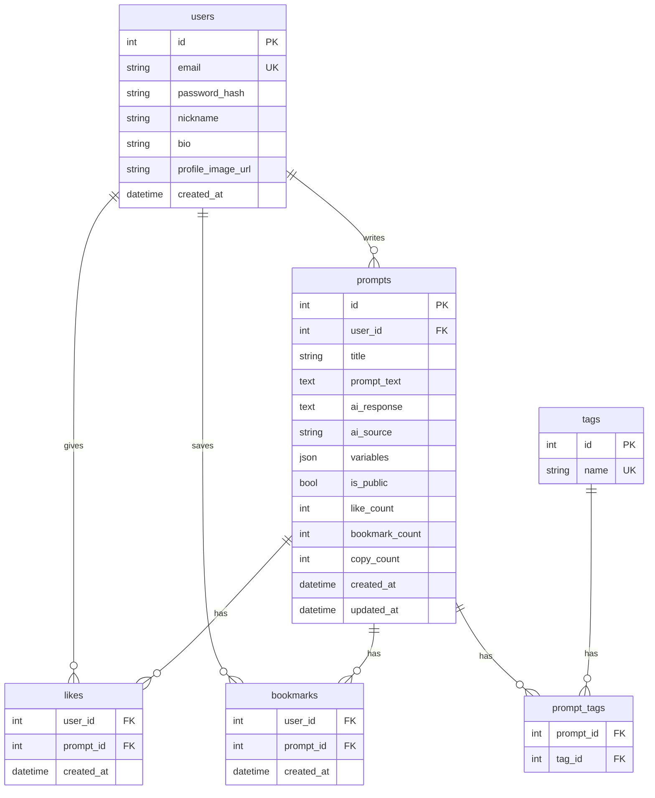

# PromptGram — 기능 명세서 (v2, refined)

> AI 프롬프트를 카드 형태로 아카이빙하고 공유·발전시키는 소셜 피드 서비스.
> 이 문서는 Claude Code에 물려 milestone을 쪼개기 전, 구현 기준이 되는 **spec 문서**다.

---

## 0. 프로젝트 개요

| 항목 | 내용 |
| --- | --- |
| 서비스 한 줄 정의 | 휘발되기 쉬운 유용한 AI 프롬프트를 시각적 카드로 저장하고, 태그로 모아보고, 공유·발전시키는 서비스 |
| 핵심 타겟 | 생성형 AI(ChatGPT, Gemini, Claude 등)를 자주 쓰며 prompt engineering에 관심 있는 학생·개발자 |
| 핵심 차별점 | ① 변수 템플릿(재사용 가능한 프롬프트) ② AI 프롬프트 튜닝/태그 추천 ③ 카드 이미지 공유 |
| FE | Vue 3 (Composition API) + Vite + TailwindCSS |
| BE | FastAPI + SQLAlchemy 2.0 + Pydantic v2 |
| DB | PostgreSQL |
| Auth | JWT (access + refresh token 분리) |

---

## 1. 개발 우선순위 (Phase 정의)

원 기획의 기능들을 "포트폴리오에서 보여줄 순서"로 재배치했다.
Claude Code에게 milestone을 쪼개라고 할 때 이 Phase를 그대로 기준으로 쓰면 된다.

- **Phase 0 — Scaffold**: monorepo 구조, DB/Alembic, auth 뼈대, CI 없이 로컬 실행까지
- **Phase 1 — Core MVP (시그니처 포함)**: **인터랙티브 랜딩 페이지(대문)**, 회원가입/로그인, 프롬프트 CRUD, **변수 템플릿**, Masonry 피드 + cursor 무한 스크롤, 원클릭 복사, 좋아요/스크랩, 태그 검색, 정렬
- **Phase 2 — AI 차별화**: AI 프롬프트 튜닝, AI 자동 태그 추천, 카드 이미지 다운로드
- **Phase 3 — 고도화(여력 되면)**: PostgreSQL full-text search, 소셜 로그인(Kakao/Google), 팔로우/알림

---

## 2. 기능 명세

### 2-1. 사용자 관리 (User Management)

| 기능 | 상세 | Phase |
| --- | --- | --- |
| 회원가입 / 로그인 | 이메일·비밀번호 기반. 비밀번호는 bcrypt/argon2로 hashing 후 저장. 로그인 시 JWT **access token(짧게) + refresh token(길게)** 발급 | 1 |
| 토큰 갱신 | refresh token으로 access token 재발급하는 `/auth/refresh` 엔드포인트 | 1 |
| 마이페이지 (프로필) | 프로필 이미지, 닉네임, 한 줄 소개 수정 | 1 |
| 나의 아카이브 | "내가 쓴 프롬프트" / "내가 스크랩한 프롬프트" 두 탭 | 1 |
| 소셜 로그인 | Kakao / Google OAuth | 3 |

### 2-2. 프롬프트 피드 & 작성 (Feed & CRUD)

| 기능 | 상세 | Phase |
| --- | --- | --- |
| 프롬프트 작성 | 제목, **prompt_text(질문)**, **ai_response(결과)**, **ai_source(대상 모델)**, 해시태그, 공개/비공개 여부 입력 | 1 |
| 변수(빈칸) 템플릿 **(시그니처)** | 본문에 `[변수명]` 문법으로 재사용 변수 지정. **1차 구현은 단순하게**: 텍스트에서 `[...]` 패턴을 인식 → 변수별 Input 창 몇 개 렌더 → 치환해서 복사. (동적 폼 자동생성·복잡한 정규식은 나중에 고도화). 저장 시 파싱한 변수 목록을 `variables`에 보관 | 1 |
| Masonry 피드 UI | 메인 화면에서 카드 높이가 제각각인 벽돌식 레이아웃(Pinterest 스타일) | 1 |
| 무한 스크롤 | **Cursor-based pagination**(`(created_at, id)` 커서). Offset 방식 금지 — 새 글 유입 시 중복/누락 방지 | 1 |
| 카드 이미지 다운로드 | `html2canvas`로 프롬프트 카드를 이미지로 캡처해 다운로드(SNS 공유용) | 2 |
| 공개/비공개 | `is_public` 토글. 비공개는 본인만 조회 | 1 |

### 2-3. 상호작용 & 탐색 (Interaction & Search)

| 기능 | 상세 | Phase |
| --- | --- | --- |
| 원클릭 복사 | 카드 '복사' 버튼 → Clipboard API로 즉시 복사. 복사 시 `copy_count` 증가 | 1 |
| 좋아요 / 스크랩 | 토글 방식. `(user_id, prompt_id)` 유니크 제약으로 중복 방지 | 1 |
| 해시태그 검색 | 태그/키워드로 필터링. 태그는 정규화된 `tags` 테이블 기반 | 1 |
| 인기 / 최신 정렬 | 좋아요 순(인기) ↔ 최신 순 토글. 인기순은 비정규화된 `like_count` 컬럼 정렬 | 1 |
| Full-text search | PostgreSQL `tsvector` + GIN index로 본문 검색 | 3 |

### 2-4. AI 연동 (AI Integration) — 포트폴리오 차별화 핵심

| 기능 | 상세 | Phase |
| --- | --- | --- |
| 프롬프트 튜닝 | 초안 입력 → 'AI 다듬기' → 더 구체적·명확한 프롬프트로 변환. **개선안 + 개선 이유**를 함께 반환(단순 rewrite보다 설득력) | 2 |
| 자동 태그 추천 | 작성한 프롬프트 내용을 분석해 해시태그 3~5개 자동 추천. 사용자가 선택 | 2 |
| LLM Provider 추상화 | **Gemini 3 Flash 단일** provider를 `LLMProvider` 인터페이스 뒤에 둠(dev·demo 공통, 무료 티어). 면접 어필: "지금은 Gemini지만 인터페이스 추상화로 class만 추가하면 OpenAI 전환 가능" | 2 |

**AI 기능 구현 규칙**
- 모든 AI 호출은 FastAPI `async/await`로 비동기 처리(요청 중 서버 블로킹 방지)
- 동일 입력에 대한 응답 캐싱(중복 API 비용 절감)
- 사용자별 rate limit(무분별한 API 호출 방지)
- API key는 환경변수, 절대 커밋 금지
- 429(rate limit) 대응: exponential backoff + jitter 재시도 로직

**Gemini 무료 티어 주의사항 (2026년 기준)**
- Gemini 1.5 Flash / 2.0 Flash는 종료됨 → **무료 티어 기본값은 Gemini 3 Flash** (2.5 Flash-Lite는 저비용 고throughput 대안)
- Pro 계열은 2026-04-01부터 유료 전용. 무료는 Flash / Flash-Lite만
- 무료 한도(대략): ~15 RPM, ~1,500 RPD, ~1M TPM (region·계정에 따라 변동, 실제 한도는 AI Studio에서 확인)
- **무료 티어 입력·출력은 Google 모델 학습에 사용될 수 있음** → 민감정보 넣지 말 것, 데모 안내 문구 권장
- **billing 함정**: 한 GCP 프로젝트에 billing을 켜면 그 프로젝트의 무료 티어가 통째로 사라져 첫 토큰부터 과금 → 무료 프로토타입용/유료용 GCP 프로젝트 분리

---

### 2-5. 랜딩 페이지 (비로그인 대문) **(Phase 1)**

Netflix 첫 화면처럼, 로그인 전 첫 진입 시 서비스를 소개하고 CTA로 auth로 유도하는 인터랙티브 대문.

**무드 / 테마**
- 모던·미니멀 Glassmorphism, 최신 SaaS 스타일
- 기본 배경 **dark(#0A0A0A)** (galaxy 효과가 잘 사는 쪽). off-white(#F9FAFB)도 허용 대안
- 포인트 컬러 vivid blue **#0070F3** (또는 은은한 gradient)
- 폰트: Pretendard (굵은 sans-serif)

**배경 인터랙션 — '프롬프트 은하수'**
- 수십 개의 프롬프트 카드가 배경에서 위→아래/대각선으로 아주 천천히 흐름(데이터가 흐르는 느낌)
- 배경 카드는 opacity 20~30% + 약한 Gaussian blur로 원근감
- 마우스 parallax: 마우스 반대 방향으로 카드가 미세하게 floating
- 카드 hover 시 그 카드만 살짝 선명해지며 AI 툴 로고(ChatGPT/Gemini) glint

**중앙 Hero**
- 화면 중앙 집중 배치
- 메인 카피(예): "당신의 완벽한 질문, 허공에 날리지 마세요."
- 서브 카피(예, 작고 옅게): "전 세계의 검증된 프롬프트를 아카이빙하고, AI 100% 활용법을 발견하세요."

**CTA 버튼(단일)**
- 폼 없이 크고 둥근 버튼 하나
- 텍스트: **[ PromptGram 시작하기 ]** → auth 페이지로 (Google 로그인은 Phase 3에 이 버튼에 얹음)
- hover: glow(그림자 부드럽게 확산) + 좌→우 swipe light 애니메이션
- click: 카드 속으로 빨려드는 zoom-in transition 후 피드로 이동 (Vue Router transition)

**성능 가드레일 (필수)**
- 배경 카드 수 상한(예 ~30개), 애니메이션은 `transform`/`opacity`만(레이아웃 리플로우 금지)
- `mousemove`는 throttle/rAF, `prefers-reduced-motion` 존중(모션 최소화 대체 제공)

---

## 3. 데이터베이스 설계 (PostgreSQL)

### 3-1. ERD

### 3-2. 원 기획 대비 스키마 변경점

| 변경 | 이유 |
| --- | --- |
| `prompts.ai_source` 추가 | 어떤 모델용 프롬프트인지 — 아카이브의 핵심 메타데이터, 필터/검색에 활용 |
| `prompts.variables` (JSON) 추가 | 변수 템플릿의 변수 목록·기본값 저장 |
| `prompts.is_public` 추가 | 비공개 프롬프트 지원 |
| `prompts.like_count / bookmark_count` 추가 | 인기순 정렬 성능(매번 COUNT JOIN 회피, 비정규화) |
| `prompts.updated_at` 추가 | 수정 이력 |
| `likes / bookmarks` 복합 유니크 제약 | 중복 좋아요·스크랩 방지 |

### 3-3. 인덱스 전략
- `prompts (created_at DESC, id DESC)` — cursor pagination + 최신순
- `prompts (like_count DESC)` — 인기순
- `prompt_tags (tag_id)` — 태그 검색
- `likes (user_id, prompt_id)` UNIQUE, `bookmarks (user_id, prompt_id)` UNIQUE

---

## 4. API 설계 개요 (RESTful)

| Method | Endpoint | 설명 |
| --- | --- | --- |
| POST | `/auth/signup` | 회원가입 |
| POST | `/auth/login` | 로그인 (access + refresh 발급) |
| POST | `/auth/refresh` | access token 재발급 |
| GET | `/users/me` | 내 프로필 조회 |
| PATCH | `/users/me` | 프로필 수정 |
| GET | `/prompts` | 피드 조회 (`?cursor=&sort=latest|popular&tag=`) |
| POST | `/prompts` | 프롬프트 작성 |
| GET | `/prompts/{id}` | 상세 조회 |
| PATCH/DELETE | `/prompts/{id}` | 수정 / 삭제 (작성자만) |
| POST | `/prompts/{id}/like` | 좋아요 토글 |
| POST | `/prompts/{id}/bookmark` | 스크랩 토글 |
| POST | `/prompts/{id}/copy` | 복사 카운트 증가 |
| GET | `/users/me/prompts` | 내가 쓴 프롬프트 |
| GET | `/users/me/bookmarks` | 내가 스크랩한 프롬프트 |
| POST | `/ai/tune` | 프롬프트 튜닝 (async) |
| POST | `/ai/suggest-tags` | 태그 추천 (async) |

---

## 5. 포트폴리오 어필 포인트

- **FastAPI 비동기 처리**: AI API 호출을 `async/await`로 처리해 요청 중에도 서버가 블로킹되지 않게 구현
- **Cursor-based pagination**: 실무형 무한 스크롤(offset의 중복/누락 문제 해결) — "왜 offset이 아닌가"를 설명할 수 있게
- **N+1 쿼리 방지**: SQLAlchemy `selectinload`로 tags/counts eager loading
- **비정규화 & 인덱스 설계**: 인기순 정렬 성능을 위한 counter 비정규화, 목적별 index
- **LLM Provider 추상화**: Gemini를 인터페이스 뒤에 둬 향후 OpenAI 등 교체 가능 + 캐싱 + rate limit으로 비용·호출 관리
- **Vue 컴포넌트 재사용**: `PromptCard`를 피드/마이페이지/검색결과에서 공통 사용
- **Pydantic 유효성 검사**: 비밀번호 길이, 프롬프트 글자 수 등 입력 스키마 검증

---

## 6. 결과물 프레이밍 주의
- AI 튜닝 결과는 "개선 **제안**"으로 표기(정답이 아님)
- 프롬프트 아카이브는 사용자 생성 콘텐츠 — 저작권/부적절 콘텐츠 신고 기능은 Phase 3 후보

---

## 7. 다음 단계 (승인 게이트)
이 명세서 확정 후, Claude Code로 넘길 때:
1. `CLAUDE.md`(프로젝트 규칙 + 답변 규칙 블록) 작성
2. `milestones.md`에 Phase 0~2를 self-contained 프롬프트로 분해
3. monorepo scaffold(`frontend/`, `backend/`)부터 시작